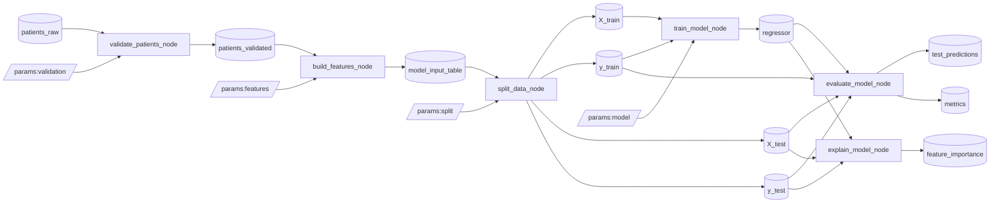

# thesis_kedro_demo — predicting diabetes progression with Kedro

A [Kedro](https://docs.kedro.org/) project that turns a raw table of diabetes patients into a trained, evaluated and explained regression model. Data flows only through named catalog datasets, the work is split into two modular pipelines, and every tunable value lives in YAML, so there are no hard-coded paths in the code.

## What it predicts

**Regression task:** predict a quantitative measure of diabetes **disease progression one year after baseline** (`progression`, roughly 25–346) from 10 baseline measurements: age, sex, BMI, average blood pressure and six blood-serum values (cholesterol, LDL, HDL, cholesterol/HDL ratio, log-triglycerides, glucose).

The project produces:
- a trained model (Ridge regression by default, Gradient Boosting as an alternative, switchable in `parameters.yml`),
- test-set predictions with absolute errors,
- a metrics report (RMSE, MAE, R², and comparison with a naive mean-predictor baseline),
- a **permutation feature importance** report showing which measurements drive the prediction.

## Dataset

- **Diabetes dataset**, Efron, Hastie, Johnstone & Tibshirani (2004), *"Least Angle Regression"*, Annals of Statistics 32(2).  
  Original source: https://www4.stat.ncsu.edu/~boos/var.select/diabetes.html
- **License note:** published by the authors for research and teaching. The copy used here is the one distributed with scikit-learn (BSD-3-Clause), in unscaled form (`load_diabetes(scaled=False)`).
- 442 patients, 10 features, 1 target. Anonymised serum columns `s1…s6` are renamed to readable names (`total_cholesterol`, `ldl`, `hdl`, `chol_hdl_ratio`, `log_triglycerides`, `glucose`), and a `patient_id` column is added.
- The raw file is committed at `data/01_raw/diabetes_patients.csv`. To regenerate it (no internet needed):

  ```bash
  python scripts/download_data.py
  ```

## Project layout

```
conf/
  base/catalog.yml        # every dataset: type + path
  base/parameters.yml     # validation rules, feature bins, split, model, evaluation
  local/                  # secrets & personal overrides (git-ignored)
  test/                   # 60-row sample environment (kedro run --env=test)
data/01_raw … 08_reporting  # Kedro data layers
src/thesis_kedro_demo/
  pipeline_registry.py    # registers data_processing, data_science, __default__
  settings.py
  pipelines/
    data_processing/      # validate -> build features
    data_science/         # split -> train -> evaluate -> explain
tests/                    # unit tests for all nodes
scripts/download_data.py  # step 0: produce the raw CSV
```

## Pipeline



| Pipeline | Node | What it does | Output |
|---|---|---|---|
| `data_processing` | `validate_patients_node` | required columns, min rows, unique `patient_id`, no NaNs, plausible ranges for age / BMI / blood pressure / glucose; fails with a list of all problems | `patients_validated` |
| `data_processing` | `build_features_node` | drops id, encodes sex as `is_male`, BMI category (WHO bins), age group, `ldl_hdl_ratio`, `bmi_x_bp` interaction | `model_input_table` |
| `data_science` | `split_data_node` | train/test split (`split.test_size`, `split.random_state`) | `X_train`, `X_test`, `y_train`, `y_test` |
| `data_science` | `train_model_node` | trains `ridge` (with StandardScaler) or `gradient_boosting`, chosen by `model.type` | `regressor` |
| `data_science` | `evaluate_model_node` | RMSE, MAE, R², baseline RMSE, % improvement | `test_predictions`, `metrics` |
| `data_science` | `explain_model_node` | permutation importance (drop in R² when a feature is shuffled) | `feature_importance` |

Interactive diagram: `pip install kedro-viz && kedro viz run`.

## Install and run

```bash
git clone <this-repo-url>
cd thesis_kedro_demo
python -m venv .venv
source .venv/bin/activate          # Windows: .venv\Scripts\activate
pip install -r requirements.txt
pip install -e .

kedro run                                    # full pipeline (__default__)
kedro run --pipeline=data_processing         # only validation + features
kedro run --pipeline=data_science            # only modelling (reads model_input_table)
kedro run --env=test                         # quick run on the 60-row sample
kedro run --params "model.type=gradient_boosting"
kedro run --params "model.ridge.alpha=10,split.random_state=7"
```

Tests: `pip install -e ".[dev]" && pytest`.

## Configuration

`conf/base/parameters.yml`:

| Key | Default | Meaning |
|---|---|---|
| `split.test_size` | 0.2 | share of patients held out for testing |
| `split.random_state` | 2026 | seed for the split |
| `model.type` | `ridge` | `ridge` or `gradient_boosting` |
| `model.random_state` | 2026 | seed for the model |
| `model.ridge.alpha` | 1.0 | L2 regularisation strength |
| `model.gradient_boosting.*` | 300 trees, lr 0.03, depth 2, subsample 0.8 | boosting hyperparameters |
| `features.bmi_bins` / `age_bins` | WHO BMI bins / 40, 55 | category boundaries |
| `validation.value_ranges` | see file | allowed ranges per column |
| `evaluation.n_repeats` | 10 | permutation importance repeats |

Environments:
- `base`: committed defaults.
- `local`: default run environment for personal overrides and secrets (`conf/local/credentials.yml`). Everything in it is git-ignored.
- `test`: points `patients_raw` at `data/01_raw/diabetes_sample.csv`, uses fewer trees and repeats. `settings.py` sets `merge_strategy: soft` for parameters, so the test environment overrides single keys instead of whole blocks.

## Results (test set, 89 patients)

| model | RMSE | MAE | R² | baseline RMSE | improvement |
|---|---|---|---|---|---|
| **ridge** (default) | 51.27 | 40.74 | 0.557 | 77.11 | 33.5 % |
| gradient_boosting | 54.58 | 45.65 | 0.498 | 77.11 | 29.2 % |

On this small dataset the simpler linear model generalises better than boosting. The most important features by permutation importance (gradient boosting run) are `log_triglycerides`, `bmi_x_bp` and `bmi`.

## Reproducibility

- **Python:** 3.9+ (developed with 3.11–3.13).
- **Kedro:** 1.x (`kedro>=1.0,<2.0`), `kedro-datasets>=7.0`; scikit-learn ≥ 1.3, pandas ≥ 2.0 (see `requirements.txt`).
- Results are deterministic: the split, the model and permutation importance all use fixed seeds from `parameters.yml`.
- Recreate the environment from scratch:

  ```bash
  python -m venv .venv && source .venv/bin/activate
  pip install -r requirements.txt && pip install -e .
  kedro run
  ```

  To pin exact versions after a successful run: `pip freeze > requirements-lock.txt`.
- The model is versioned (`versioned: true`): each run saves to `data/06_models/regressor.pickle/<timestamp>/`.
- CI (`.github/workflows/kedro-run.yml`) runs the tests, `kedro run --env=test` and `kedro run` on every push.
